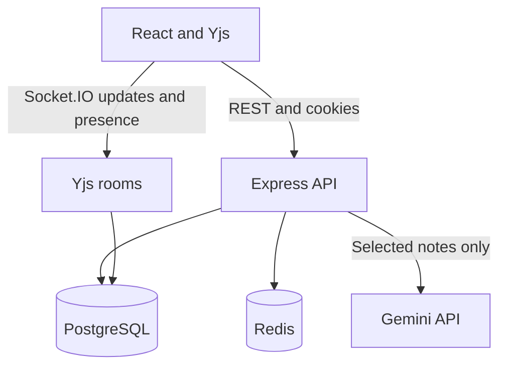

# Architecture and scope

ThinkWeave's first usable release has a React SPA and one Node.js API process, with a separate PostgreSQL database and Redis container. It is a planning board, not the seven unrelated products in the original inspiration deck.

Express and the Yjs rooms run in the same process. PostgreSQL is the durable source of truth. Redis is used for rate limits, OAuth state, and AI-result caching; there is no Redis Socket.IO adapter or distributed document ownership yet.

## How edits are saved

1. A verified user opens a board; the API checks workspace membership.
2. The browser loads its IndexedDB document, keyed by user, board, and epoch. Socket.IO authenticates the same access cookie and active database session.
3. Joining returns the server state, state vector, and current role. An editor sends any local difference. Viewers cannot submit updates.
4. The server queues operations per board version, validates the binary update, locks the board row, verifies its epoch, and inserts the update before acknowledging or broadcasting it.
5. Recipients' sessions and memberships are rechecked before update delivery. Reconnect performs another state-vector exchange, rather than assuming Socket.IO retained missed messages.

Yjs merges changes deterministically. Note fields are separate map entries; simultaneous edits to the **same text field** resolve as one string value, not character-by-character shared text editing. Updates can be stored more than once after a lost acknowledgement, but Yjs applies the same operations idempotently. Undo/redo applies to the user's local actions. Server-applied AI tasks are not part of that local undo history; use a snapshot to restore a prior board.

## Restore and offline edits

Snapshots contain the entire Yjs document and a last-update marker. Restoring creates a new epoch and its initial update in one database transaction, then disconnects clients from the previous room. The next join must use the new epoch. This prevents an offline old document from merging deleted content back into the restored version.

Export local notes **before reloading** if the UI reports a restore while you have unsynced edits. The old IndexedDB database is retained, but the new board view loads only the new epoch. There is no export-import or old-cache recovery UI in this release.

Offline editing works after a board has been opened online in the current tab. This is not an installable PWA: a fresh navigation/reload still requires the API for authentication and board metadata. Browser storage can be unavailable, cleared, or evicted. Local caches are per user but not encrypted; use a private browser profile on shared devices. No remote revocation can erase data already downloaded to a device.

## AI boundary

Only user-selected note text is sent to the configured Gemini model. The API uses a fixed system instruction, a JSON response schema, a 30-second timeout, and independent validation of 1–10 task strings. It has no tool execution, external navigation, or permission-changing capability. Suggestions remain untrusted content rendered as text.

The Redis cache lasts five minutes and is scoped to user, board, epoch, model, and notes hash. A cache hit still creates a new reviewable proposal. Pending plans are private to their requester. Approval checks current editor permissions and epoch, and writes the proposal status and generated Yjs update atomically. Repeated approval returns the recorded outcome without duplicating tasks. The UI receives the resulting update over Socket.IO; reconnect reloads it if the connection drops.

## Operational limits

- One API process owns all rooms. Do not run clustered Node workers or multiple replicas; PostgreSQL row locks alone do not make multiple in-memory Yjs documents coherent.
- Incoming updates are limited to 256 KiB. A very large offline difference can be rejected; export it before closing the tab. Update rows and snapshots have no compaction or retention job yet.
- Socket edits are bounded per connection, cursor traffic is throttled, and requests are authenticated. There are no measured throughput, canvas-size, or concurrent-user guarantees.
- Room documents are evicted after idle time. Presence counts browser connections, so multiple tabs count separately.
- Board archive hides the board; there is no unarchive UI. Workspace deletion, ownership transfer, rich documents, comment threads, semantic search, attachments, worker queues, and provider integrations beyond login/email/AI planning are not implemented.
- The existing authentication rate limiter is IP-based. Express does not trust proxy headers by default. Configure an exact trusted proxy policy for your own infrastructure before placing it behind a proxy.
- Production needs HTTPS, same-site frontend/API hosting, secure secret delivery, database backups, recovery drills, monitoring, and retention policies. These are deployment tasks; this repository does not claim a live production deployment.

## Validation recorded for this release

Local Prisma generation/validation, server type checking/build, and client production build are run during development. A temporary manual Socket.IO harness uses mocked storage to exercise update delivery, viewer rejection, reconnect, snapshot restore, and repeated AI approval. Mock storage cannot validate PostgreSQL locking, rollback, migrations, foreign keys, OAuth redirects, email delivery, browser rendering, or Gemini output. Follow the walkthrough with real configured services before using the app with a team.
